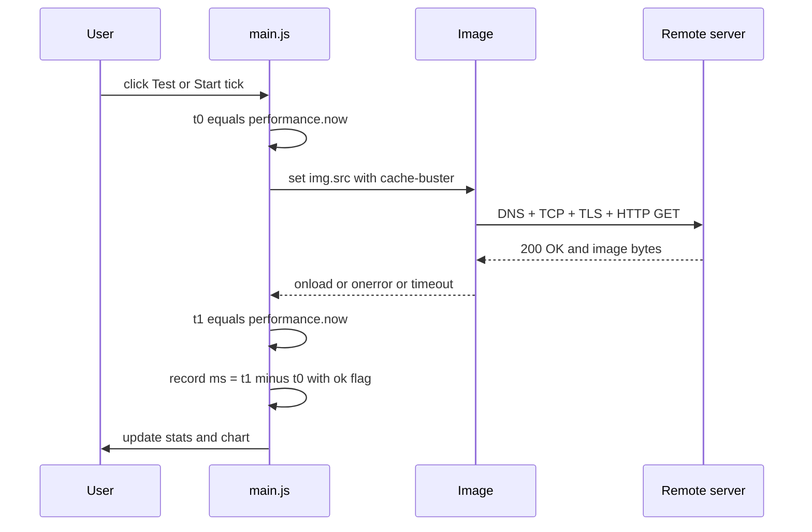
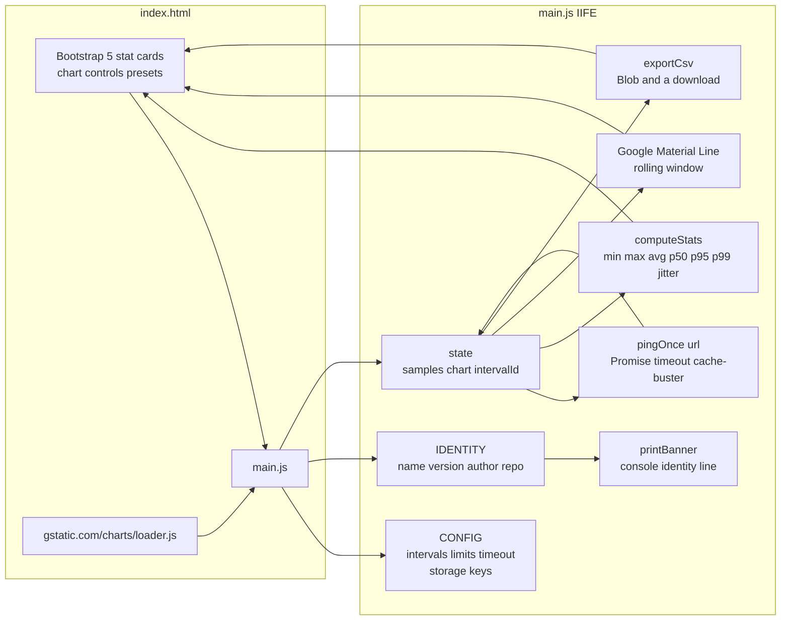

# SLICEisScope

**Browser-based HTTP round-trip latency tester with real-time statistics, percentiles, and CSV export.**

Measure the time it takes a browser to fetch a remote resource, watch the
latency curve update live, and export every sample as CSV — no server, no
build step, no dependencies beyond a browser and a CDN.

**Maintained by [`SL_CE'I_`](https://github.com/DoTMob/)**

> *SL_CE'I_ → SLICE'IS → "Slice is" → **Internet Security**, by design.*
> The two letters hidden behind the underscores spell **IS**.

[](#changelog)
[](#license)
[](#requirements)
[](https://github.com/DoTMob/)

> ### ⚠️ Measurement tool, not a scanner
>
> SLICEisScope makes **one HTTP request per probe**, to the URL you specify,
> from your own browser. It does not scan, crawl, or probe any host you did
> not type into the address field. It is a client-side measurement tool, not
> a network reconnaissance utility.

---

## Table of contents

- [Why SLICEisScope](#why-sliceisscope)
- [Why the name](#why-the-name)
- [Part of the suite](#part-of-the-suite)
- [Important: it is not ICMP ping](#important-it-is-not-icmp-ping)
- [How the measurement works](#how-the-measurement-works)
- [Architecture](#architecture)
- [Features](#features)
- [Statistics reference](#statistics-reference)
- [Files](#files)
- [Requirements](#requirements)
- [Usage](#usage)
- [Keyboard shortcuts](#keyboard-shortcuts)
- [Configuration](#configuration)
- [Security & privacy](#security--privacy)
- [Limitations](#limitations)
- [Changelog](#changelog)
- [License](#license)

---

## Why SLICEisScope

Most "ping" pages you find in a web search are broken in at least one of three
ways:

1. They hard-code the target. You type a URL, they ignore it.
2. They use Google's `jsapi.js` loader from 2014. It cannot load
   `google.charts.Line`, so the chart never renders.
3. They treat every result as a success. A timeout, a DNS failure, and a real
   measurement all get plotted identically, which makes the numbers useless
   for diagnosing anything.

SLICEisScope is the fixed version of that entire genre:

- **The address field is honored.** Type any `http(s)://` URL.
- **The chart actually loads.** Modern `charts/loader.js`, not `jsapi.js`.
- **Results are classified.** Success, network error, and timeout are distinct
  events with distinct semantics.
- **Statistics you can act on.** Not just high/low — you get p50/p95/p99,
  jitter, average, and a running sample count.
- **Data leaves with you.** One-click CSV export of every measurement.

---

## Why the name

**SLICEisScope** is a phonetic expansion of the author's tag `SL_CE'I_`:

| Form | Reading |
|---|---|
| `SL_CE'I_` | The tag — two underscores hide two letters |
| `SLICE'IS` | Expanded — the hidden letters are **I** and **S** |
| "Slice is" | Phonetic — reads as the English words |
| **I**nternet **S**ecurity | What the hidden IS stands for |
| SLICEisScope | The product — "Slice is Scope" |

The GitHub slug is `SLICEisScope` (no apostrophe, no quotes) because GitHub
only accepts alphanumerics, hyphens, underscores, and periods in repo URLs.
Everywhere a human reads the name — title, badges, footer, docs — the full
tag `SL_CE'I_` is preserved and linked to the author's profile.

The tool was internally named **LatencyScope** during its v3.0.0 rewrite.
The rename to SLICEisScope in v3.1.0 is identity-only: the source files
(`index.html`, `main.js`), the measurement logic, the chart, the statistics,
and the CSV export are all unchanged. Existing users keep their saved
address and interval settings (auto-migrated from the old `localStorage` key).

---

## Part of the suite

SLICEisScope is one of three defensive tools published under the `SL_CE'I_`
handle. The naming convention ties them together:

| Tool | Function | Repo |
|---|---|---|
| **SLICEisGuard** | WireGuard server installer and client manager | `github.com/DoTMob/SLICEisGuard` |
| **SLICEisDeflate** | Connection-count based IP blocker (`ipset` + `iptables`) | `github.com/DoTMob/SLICEisDeflate` |
| **SLICEisScope** | HTTP round-trip latency tester (this repo) | `github.com/DoTMob/SLICEisScope` |

Each tool covers a distinct layer of the defense stack:

- **SLICEisGuard** — the encrypted tunnel. Confirms traffic can flow privately.
- **SLICEisDeflate** — the firewall. Drops abusive peers when they misbehave.
- **SLICEisScope** — the measurement. Verifies what the user actually
  experiences at the HTTP layer, not just what the kernel reports at the
  network layer.

Together they answer three questions: *is the path private, is the path
protected, and is the path fast?* None of the three substitutes for the
other two.

---

## Important: it is not ICMP ping

This tool does **not** measure ICMP echo. There is no `ping` syscall in a
browser, and no way to send raw ICMP from JavaScript.

What it *does* measure is the wall-clock time from "start loading an image"
to "the browser reports the image is loaded." That number includes:

| Layer | What it contributes |
|---|---|
| DNS | resolver lookup (usually cached after the first hit) |
| TCP | three-way handshake to the server |
| TLS | certificate handshake (first request only, then reused) |
| HTTP | request + response headers |
| Body | download of the image bytes |
| Browser | decode + paint-callback dispatch |

That is why SLICEisScope numbers are typically 20–100 ms higher than an ICMP
ping to the same host. It is a **full-stack round trip**, which is often the
number you actually care about — but it is not a network-layer measurement.

Use SLICEisScope for:

- Verifying that a CDN is responding quickly from your browser
- Comparing several endpoints from the same vantage point
- Producing a CSV of HTTP RTT over time for a demo or an incident review

Use your OS's `ping` (or `mtr`) for:

- Network-layer latency and packet loss
- Route diagnosis
- Anything involving a router or ISP

---

## How the measurement works



Every probe uses a fresh cache-buster query string (`?_t=<timestamp>`), so the
browser must actually contact the server. Without it, a second request to the
same favicon would be served from cache in ~0 ms and the numbers would be
meaningless.

Probes are also bounded by a **5-second timeout**. If the image neither loads
nor errors within that window, the sample is recorded as `ok=false` with the
elapsed time — a real measurement of "took at least 5 seconds," not a
discarded request.

---

## Architecture



### State shape

```js
state = {
  running:    false,          // loop active?
  intervalId: null,           // setInterval handle
  inFlight:   false,          // a probe is in progress
  samples:    [],             // rolling window, max 200
  nextIndex:  1,              // monotonic sample counter for the x-axis
  chart:      null,           // google.charts.Line instance
  dataTable:  null            // google.visualization.DataTable
}
```

Each sample is:

```js
{ i: number, t: number /* ms epoch */, ms: number, ok: boolean }
```

---

## Features

| Feature | Notes |
|---|---|
| Honor the address field | Any `http(s)://` URL, validated |
| Preset targets | Google, Facebook, Cloudflare, Wikipedia, GitHub (extensible) |
| Test once | One probe, no timer |
| Start / Stop | Repeating probes at a configurable interval (min 1000 ms) |
| Reset | Clear samples, chart, and stats |
| Export CSV | `sample, timestamp_iso, ms, ok` — one row per probe |
| Live stat cards | Ping, Last, Highest, Lowest, Average, Samples, p50, p95, p99, Jitter |
| Rolling window | Stats and chart both cap at 200 samples (configurable) |
| Timeout classification | Network error and timeout are distinct from success |
| Settings persistence | Address and interval remembered via `localStorage` |
| Backward compatibility | Reads the LatencyScope-era storage key on first load |
| Keyboard shortcuts | Space / Esc / R |
| Auto-pause on hidden tab | Stops probing when the tab goes to the background |
| Responsive layout | Bootstrap 5 grid, mobile through desktop |
| Accessibility | `<label for>` on inputs, `role="status"` on the badge, `aria-label` on the chart |
| Console banner | One-line identity (`SLICEisScope v3.0.0 SL_CE'I_ <repo>`) on boot |
| Author attribution | Visible in header, footer, and every badge |

---

## Statistics reference

| Card | What it means |
|---|---|
| **Ping** | The most recent measurement, in milliseconds |
| **Last** | Same as Ping — kept as a separate card for readability |
| **Highest** | Maximum value in the current rolling window |
| **Lowest** | Minimum value in the current rolling window |
| **Average** | Arithmetic mean of all samples in the window |
| **Samples** | Number of samples currently held (caps at 200) |
| **p50** | Median — half the samples are below this value |
| **p95** | 95th percentile — the tail most users never notice |
| **p99** | 99th percentile — the tail that shows up in incident reports |
| **Jitter** | Mean absolute difference between consecutive samples |

**Why percentiles beat "highest":** a single outlier will always dominate the
"Highest" card. p95 and p99 tell you what the slow end of *normal* traffic
looks like, which is what you actually feel as a user.

**Why jitter matters:** two connections can have the same average latency and
feel completely different. A steady 50 ms is fine for a voice call; 50 ms
average with 40 ms of jitter is not. Jitter is the metric that exposes that.

---

## Files

| File | Type | Purpose |
|---|---|---|
| `index.html` | markup | UI, stat cards, chart container, controls, presets |
| `main.js` | code | All probe logic, statistics, chart, persistence, export |
| `README.md` | docs | This file |

> **Note on `jsapi.js`:** The project this was forked from shipped a fourth
> file, `jsapi.js`, containing Google's AJAX API loader from 2014. That API
> was deprecated in 2019 and cannot load `google.charts.Line`. It has been
> removed. The chart now loads via
> `https://www.gstatic.com/charts/loader.js` from `index.html`.

---

## Requirements

| Component | Minimum | Notes |
|---|---|---|
| Browser | Any modern one | Chrome, Firefox, Edge, Safari — `performance.now()` + `Promise.finally()` required |
| Internet access | Required | The page loads Bootstrap and Google Charts from CDNs |
| Web server | Optional | The page is static; open it with `file://` or serve it |

No build step. No npm. No backend. No telemetry.

---

## Usage

### 1. Serve the page

You can open `index.html` directly, but for the best experience (and to avoid
some browsers' `file://` restrictions on `localStorage`), serve it locally:

```bash
python3 -m http.server 8000
# then visit http://localhost:8000
```

Or drop the three files onto any static host (GitHub Pages, Netlify, S3, nginx).

### 2. Configure a target

Type any `http(s)://` URL into the **Address** field. A small image is
preferable — a favicon or a 1×1 pixel — because you are measuring round trip,
not throughput.

### 3. Choose an interval

Minimum is **1000 ms**. The default is **5000 ms** (5 seconds). The value is
clamped in JavaScript, not just by the HTML `min` attribute, so pasting `0`
will not freeze the browser.

### 4. Probe

- **Test once** — a single probe. Useful for a spot check.
- **Start** — begins the repeating loop.
- **Stop** — ends the loop; results remain visible.
- **Reset** — clears samples and stats.

### 5. Export

Click **Export CSV** at any time while samples exist. The file is named
`sliceisScope-<ISO timestamp>.csv` and contains one row per sample:

```csv
sample,timestamp_iso,ms,ok
1,2025-01-15T14:02:11.481Z,42.7,1
2,2025-01-15T14:02:16.504Z,45.2,1
3,2025-01-15T14:02:21.518Z,5000.0,0
```

`ok=0` means the probe failed (network error or timeout) — the `ms` value is
still meaningful, it is the time until failure.

---

## Keyboard shortcuts

| Key | Action |
|---|---|
| `Space` | Start if stopped, stop if running |
| `Esc` | Stop (if running) |
| `R` | Reset (only when stopped) |

Shortcuts are ignored while focus is inside the address or interval field, so
typing in them never triggers the loop.

---

## Configuration

All tunables live in the `CONFIG` object at the top of `main.js`:

```js
var CONFIG = {
    MIN_INTERVAL_MS: 1000,           // floor for the interval field
    MAX_INTERVAL_MS: 60 * 60 * 1000, // ceiling (1 hour)
    MAX_SAMPLES: 200,                // rolling window for stats + chart
    PING_TIMEOUT_MS: 5000,           // per-probe timeout
    STORAGE_KEY: 'sliceisScope.settings.v1',
    LEGACY_STORAGE_KEY: 'pingTester.settings.v1'
};
```

Common changes:

| If you want… | Change |
|---|---|
| More history on the chart | Raise `MAX_SAMPLES` (memory grows linearly) |
| Faster probing | Lower `MIN_INTERVAL_MS`, but respect the target server |
| A longer probe budget | Raise `PING_TIMEOUT_MS` (slows the whole loop) |
| No persistence | Delete the `STORAGE_KEY` line or clear `localStorage` |

The storage key is namespaced with a version suffix (`v1`), so changing the
schema in a future version will not break existing users. The legacy key is
read once to migrate LatencyScope-era settings, then never written again.

---

## Security & privacy

- **No server.** Everything runs in the browser.
- **No analytics, no telemetry.** The only network requests are:
  1. Bootstrap CSS/JS and Google Charts from their CDNs.
  2. Your chosen target's URL, once per probe.
- **CSP meta tag** restricts script sources to `self`, `gstatic.com`, and
  `cdn.jsdelivr.net`. If you host third-party scripts, add their origins.
- **SRI hashes** are present on the Bootstrap CDN tags. Verify them against
  jsDelivr if you upgrade Bootstrap.
- **`localStorage`** stores only `{ address, time }` — never samples.
- **No `eval`, no `innerHTML` with user data.** All dynamic text goes through
  `textContent` or Bootstrap's DOM APIs.
- **Cache-buster query strings** are the only way probes are identified —
  they contain a millisecond timestamp in base 36 and nothing else. No
  cookies, no fingerprinting, no correlation across pages.

### A note on `file://` usage

Opening `index.html` directly from disk works, but some browsers disable
`localStorage` and CSP under `file://`, and the preset addresses may be
blocked by CORS in rare configurations. Running through `http.server` or any
static host is the supported path.

---

## Limitations

- **Not ICMP.** See the [dedicated section](#important-it-is-not-icmp-ping).
- **CORS-opaque responses.** Some servers respond to favicon requests with
  headers that browsers treat as cacheable-but-not-loadable. Those probes
  register as `ok=false` even though the server *did* respond — this is a
  browser limitation, not a bug.
- **DNS and TLS are amortized.** After the first probe, DNS is cached and TLS
  is reused. Subsequent samples measure TCP + HTTP + body, not the full stack.
  That is usually what you want, but be aware of it.
- **No concurrency control.** Each probe runs sequentially; `inFlight` guards
  against overlap, so a slow target effectively caps the probe rate.
- **Chart library requires network.** If `gstatic.com` is unreachable, the
  chart cannot load; the page reports this as a status error rather than
  silently failing.
- **Precision is browser-bound.** `performance.now()` is coarsened for
  fingerprinting resistance (typically to 100 µs–1 ms depending on browser).
  For sub-millisecond work, use `curl -w` or a dedicated tool.

---

## Changelog

### v3.1.0 — first release under the SLICEisScope name

> **Renaming note (identity-only):** The tool was internally named
> **LatencyScope** during its v3.0.0 rewrite and is now published as
> **SLICEisScope** to fit the `SL_CE'I_` suite naming convention. No
> functional changes.
>
> **Renamed:**
> - Title, header, and footer: `Ping Tester` / `LatencyScope` → `SLICEisScope`
> - `<title>` tag and `<meta name="description">`
> - `localStorage` key: `pingTester.settings.v1` → `sliceisScope.settings.v1`
> - Chart title: `Latency (ms)` → `SLICEisScope — latency (ms)`
> - CSV filename: `ping-<ts>.csv` → `sliceisScope-<ts>.csv`
> - Added `IDENTITY` constant and console banner on boot
>
> **Unchanged:** every function, event binding, calculation, timeout,
> shortcut, and button-state transition. The `main.js` diff for this release
> touches only the header comment, the `CONFIG` object (storage keys), the
> chart title string, the CSV filename string, and the new
> `IDENTITY`/`printBanner()` pair.
>
> **Backward compatibility:** existing LatencyScope users have their saved
> `address` and `interval` migrated on first load. No action required.

### v3.0.0 — the rewrite that fixed the original

Two functional bugs fixed:

| # | Bug (original) | Fix |
|---|---|---|
| 1 | `test()` ignored the Address field and always pinged `facebook.com` | Address is validated and honored; presets are explicit buttons |
| 2 | Chart loaded `jsapi.js` (Google AJAX API, deprecated 2019) which cannot instantiate `google.charts.Line` | Loads `https://www.gstatic.com/charts/loader.js`; `jsapi.js` removed |

Thirty enhancements, grouped:

- **Correctness** — `performance.now()` instead of `Date.getTime()`; timeout
  and error are distinct from success; per-probe `setTimeout` is now cleared;
  address validated against `http(s)://`; interval clamped in JS, not just by
  HTML `min`.
- **Memory** — `samples[]` and the chart's `DataTable` both cap at
  `MAX_SAMPLES`; no more unbounded growth.
- **UI/UX** — Bootstrap 5.3 (upgraded from 3.3.5, which is EOL with known
  CVEs); responsive stat grid; status badge; average, p50/p95/p99, sample
  count, and jitter cards; disabled states during in-flight probes; preset
  targets.
- **Workflow** — CSV export; `localStorage` persistence; keyboard shortcuts;
  auto-pause on hidden tab; `input` event for the interval field (was
  `change`, which only fired on blur).
- **Robustness** — IIFE scope, `'use strict'`, no global `Array.prototype`
  pollution, `beforeunload` cleanup, CSP meta tag, SRI on CDN assets.

---

## Credits

The measurement technique — load an image and time it — is decades old and
has been described in many places; the
[Stack Overflow question on JS ping](https://stackoverflow.com/questions/4282151/is-it-possible-to-ping-a-server-from-javascript)
is the most-linked reference. The chart library is
[Google Charts](https://developers.google.com/chart), loaded from
`gstatic.com`. The UI framework is
[Bootstrap 5](https://getbootstrap.com).

---

## License

MIT — see `LICENSE`. Choose and commit a license file before publishing.

---

<p align="center">
  <strong>SLICEisScope</strong> — HTTP round-trip, measured honestly.<br/>
  <sub>Maintained by <a href="https://github.com/DoTMob/"><code>SL_CE'I_</code></a> · MIT License</sub>
</p>
